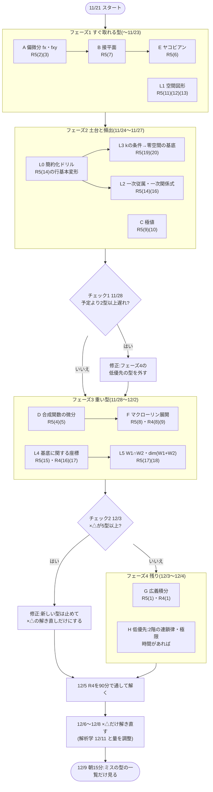
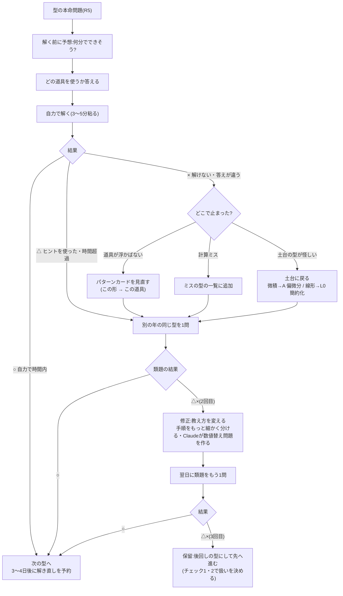

# 数学演習第二 中間(2026-12-09)学習フローチャート

元データ:[過去問分析](past-exam-analysis.md)

## 考え方
- **効率 = 出る問数 ÷ 覚えるコスト**が大きい型から順に進める。
- 土台になる型を先に固める。微積は偏微分、線形は簡約化。土台がないと、その上の型が全部崩れる。
- 教材は過去問そのものを使う。本命はR5で、類題は別の年の同じ型にする(解答・解説つきで、数値だけ違う)。足りなければClaudeが作る。
- 1回は電車の15分で1〜2問。目安は1問4.5分(90分÷20問)。

## 1. 学ぶ順番(全体)

## 2. 1つの型の回し方(修正ループ)

## 3. 修正のルール(うまくいかないとき)
| いつ | 起きたこと | 修正 |
|---|---|---|
| 1問ごと | 予想時間の2倍以上かかった | 計算の速さの問題として、同じ型の類題を時間を測ってもう1問 |
| 1つの型 | 類題でも2回続けて△× | 教え方を変える(手順をもっと細かく分ける、数値替え問題) |
| 1つの型 | 3回続けて△× | 保留にして先へ進む。チェックで扱いを決める |
| チェック1(11/28) | 予定より2型以上遅れている | 低優先の型(H:2階の連鎖律・極限)を外す。それでも遅れていれば、G 広義積分も後回しにする |
| チェック2(12/3) | ×△の型が5つ以上ある | 新しい型を止め、×△の解き直しだけにする |
| 12/5 通し演習 | 70点未満、または時間が足りない | 12/6〜12/8は、点を落とした型と時間を食った型だけを解き直す |
| いつでも | 順番が合わないと感じた | Claudeに言えば、このフローチャートを直す |

## 4. 記録
解くたびに「型・問題・○△×・かかった時間・止まった所」を記録する。チェック1・2では、その記録で遅れと×△の数を判断する。
